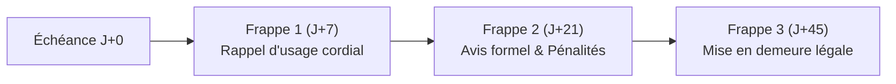

# ⚖️ GABARIT : SÉQUENCE IMPLACABLE DE RECOUVREMENT

*Ce gabarit contient les modèles types déployés par la commande `!RECOUVREMENT` pour récupérer les sommes impayées avec rigueur, calme et efficacité juridique.*

---

## 📅 Chronologie des 3 Frappes

---

### 📬 Frappe 1 : Le Rappel de Bonne Foi (J+7 après échéance)
**Objet :** Suivi de votre facture #[Numéro] — [Nom de l'Entreprise]

> *« Bonjour [Nom du Client],  
> Sauf erreur ou omission de notre part, la facture #[Numéro] d'un montant de [Montant] $, émise le [Date] et venue à échéance le [Date d'échéance], apparaît toujours impayée dans notre registre.  
> Vous trouverez en pièce jointe une copie de cette facture pour votre commodité.  
> Merci de bien vouloir procéder au règlement par virement Interac à [Courriel de virement] ou par chèque d'ici les prochains jours.  
> Si votre paiement a déjà été expédié entre-temps, veuillez ignorer ce message.  
> Cordialement,  
> [Votre Nom / Votre Entreprise] »*

---

### ⚠️ Frappe 2 : L'Avis Formel & Suspension de Service (J+21 après échéance)
**Objet :** DEUXIÈME AVIS — Facture impayée #[Numéro] — Retard et pénalités applicables

> *« Bonjour [Nom du Client],  
> Malgré notre premier rappel du [Date du 1er rappel], le solde de [Montant] $ rattaché à la facture #[Numéro] demeure en souffrance depuis plus de 21 jours.  
> Conformément aux conditions de paiement stipulées à notre contrat d'origine, des frais d'intérêt de retard au taux de 2% par mois (24% par an) commencent à s'appliquer à compter de ce jour.  
> De plus, tout nouveau travail ou intervention de garantie est suspendu jusqu'à la régularisation complète de ce solde.  
> Nous vous demandons de régulariser ce paiement d'ici le [Date limite à J+5] afin d'éviter le transfert de votre dossier vers notre procédure de contentieux formel.  
> Sincères salutations,  
> [Votre Nom / Votre Entreprise] »*

---

### 🛑 Frappe 3 : Projet de Mise en Demeure / Pré-Contentieux (J+45 après échéance)
**Objet :** MISE EN DEMEURE — AVIS FORMEL AVANT POURSUITE JUDICIAIRE

> *« SOUS TOUTES RÉSERVES DE TOUS NOS DROITS ET RECOURS  
>   
> À l'attention de : [Nom du Débiteur / Entreprise]  
> Adresse : [Adresse]  
>   
> Madame, Monsieur,  
>   
> Veuillez noter que la présente constitue une **MISE EN DEMEURE** formelle.  
> Malgré nos multiples relances des [Dates des relances], vous êtes en défaut de paiement concernant la facture #[Numéro] pour des travaux exécutés et livrés conformément à l'entente signée le [Date].  
>   
> Le solde impayé s'élève à [Montant] $, auquel s'ajoutent les intérêts contractuels de retard de [Montant des intérêts] $, pour un montant total réclamé de **[Total dû] $**.  
>   
> À défaut d'avoir reçu le paiement complet sous forme certifiée d'ici un délai péremptoire de **DIX (10) JOURS** suivant la réception du présent avis, des procédures judiciaires formelles seront immédiatement entreprises contre vous devant la division des Petites Créances de la Cour du Québec, sans autre préavis ni délai.  
>   
> Tous les frais judiciaires, indemnités et intérêts applicables prévus par la loi vous seront alors réclamés en sus.  
>   
> VEUILLEZ AGIR EN CONSÉQUENCE.  
>   
> Fait à [Ville], le [Date du jour].  
>   
> _____________________________  
> [Votre Nom / Titre]  
> [Nom de votre Entreprise] »*
